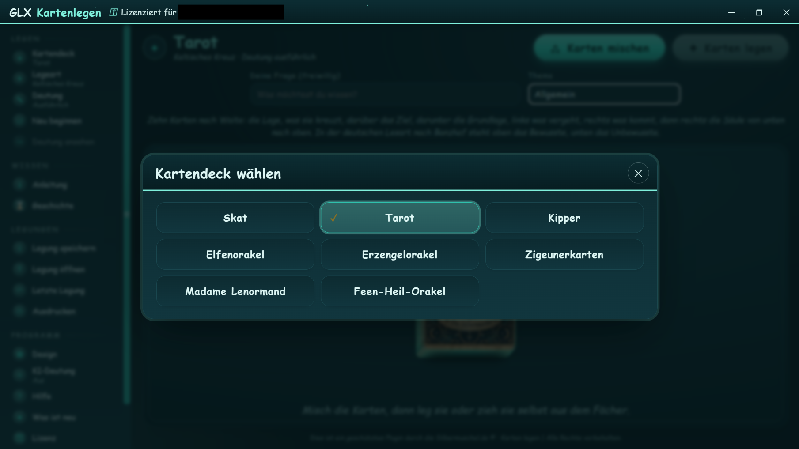
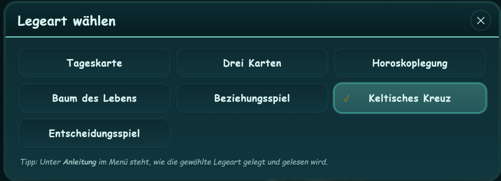
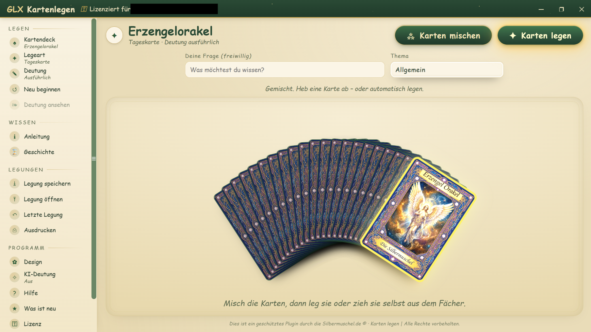
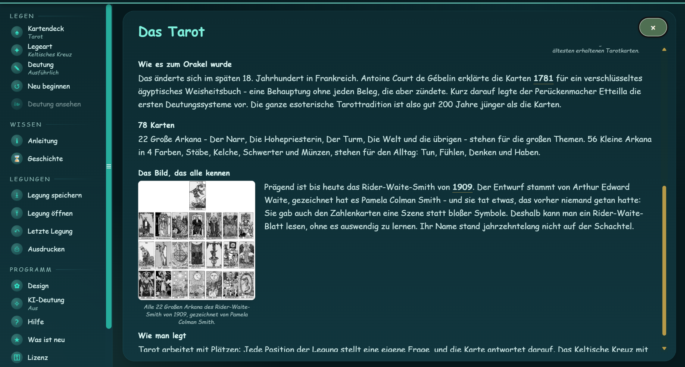
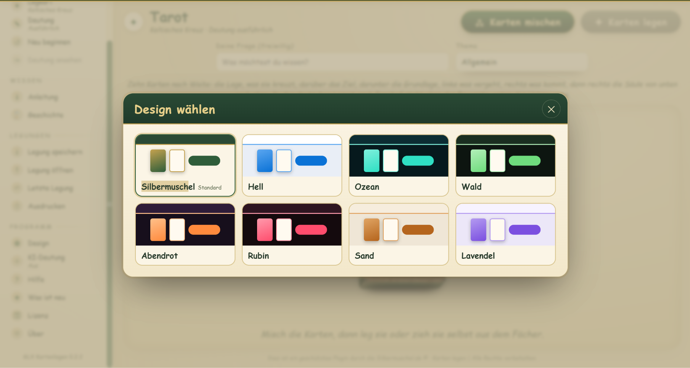
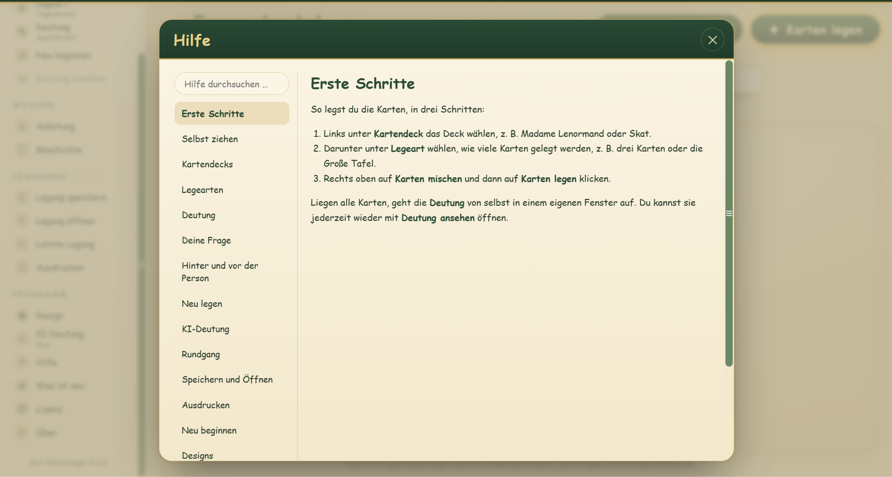

🌍 Sprachen: [🇺🇸 English](README.md) | [🇩🇪 Deutsch](README.de.md)

# 💠 GLX Kartenlegen

### Karten legen wie am eigenen Tisch.

*Acht Kartendecks, viele Legesysteme und ausführliche Deutungen in einem Windows-Programm, ohne Browser und ohne Werbung. Bedienoberfläche auf Deutsch.* ⚡

   

---

## ⬇️ Download

👉 Neueste Version: [Releases](../../releases/latest)  
👉 Shop und Lizenzen: [glx-tools.de](https://glx-tools.de/product/glx-kartenlegen/)

---

## 📖 Über GLX Kartenlegen

### Kartenlegen wie am eigenen Tisch

GLX Kartenlegen bringt den Kartenleger von silbermuschel.de als eigenes Programm auf deinen Windows-PC. Rechts liegt groß der Kartentisch, links ein kleines, übersichtliches Menü. Du mischst, legst und liest die Deutung in Ruhe, ganz ohne Browser und ohne Werbung.

### Entstanden mit Regina Toumi

GLX Kartenlegen und alle Kartenlegesysteme darin sind in Zusammenarbeit mit Regina Toumi entstanden. Mit ihrer Unterstützung wurden die Decks, die Legearten und die Deutungen zusammengestellt, damit sie sich anfühlen wie eine Legung am echten Tisch.

### Acht Kartendecks in einem Programm

Madame Lenormand (36 Karten), Kipper (36), Tarot (78), Skat (32), Zigeunerkarten (52), Elfenorakel (55), Erzengelorakel und Feen-Heil-Orakel. Jedes Deck mit seinen eigenen, liebevoll gestalteten Kartenbildern und Kartenrücken.

### Mischen, abheben, legen

Mit einem Klick werden die Karten gemischt und als Fächer auf den Tisch gelegt. Du lässt das Programm legen oder ziehst selbst Karte für Karte aus dem Fächer. Jede Karte wandert an ihren Platz, und ein Klick auf eine gelegte Karte zeigt ihre Bedeutung genau an dieser Stelle.

### Legearten von der Tageskarte bis zur Großen Tafel

Jedes Deck hat seine eigenen Legearten, von einer einzelnen Karte über drei oder fünf Karten bis zur Großen Tafel mit allen 36 Lenormandkarten. Die Anleitung zeigt mit einer Zeichnung, wo welche Karte liegt, und erklärt, wie gelegt, aufgedeckt und gelesen wird.

### Deutung kurz oder ausführlich

Liegen alle Karten, öffnet sich die Deutung von selbst im großen Fenster: zuerst eine Gesamtaussage mit einem Rat, darunter jede Karte zum Aufklappen. Du wählst, ob kurz oder ausführlich gedeutet wird. Die Deutung lässt sich ausdrucken oder als PDF speichern.

### Legungen speichern und weitergeben

Jede Legung speicherst du als kleine Datei mit der Endung .ginax. Ein Doppelklick darauf öffnet GLX Kartenlegen und legt dieselben Karten mit derselben Deutung wieder auf den Tisch. So kannst du Legungen aufheben oder an andere schicken, die GLX Kartenlegen auch haben.

### Geschichte der Decks

Woher kommt das Lenormand, wie ist das Tarot entstanden? Zu jedem Deck gibt es die Geschichte und Tipps zum Lesen, direkt im Programm, groß und gut lesbar.

### Warm, übersichtlich, für jeden leicht

8 Designs: Silbermuschel, Hell, Ozean, Wald, Abendrot, Rubin, Sand und Lavendel. Große Knöpfe, eine freundliche Schrift, Hinweise beim Zeigen mit der Maus und eine eingebaute Hilfe mit Suche. Das Programm startet im Vollbild und merkt sich dein Design.

### Dein Rechner, deine Karten

GLX Kartenlegen arbeitet auf deinem PC. Karten, Deutungen und gespeicherte Legungen werden nicht ins Internet geschickt. Nur die Update-Suche fragt bei glx-tools.de nach einer neuen Version, die du dann mit einem Klick installierst.

### 14 Tage kostenlos testen

Probiere alles 14 Tage lang ohne Einschränkung aus. Danach schaltest du das Programm mit deinem Lizenzschlüssel frei. Anleitung und Geschichte der Decks bleiben auch ohne Lizenz frei lesbar.

---

## 📸 Überblick & Screenshots

### 1️⃣ Acht Kartendecks zur Auswahl

### 2️⃣ Legeart wählen

### 3️⃣ Karten selbst aus dem Fächer ziehen

### 4️⃣ Hintergrundwissen zu jedem Deck

### 5️⃣ Design wählen

### 6️⃣ Integrierte Hilfe

---

## ✨ Funktionen

- 🚀 **Acht Kartendecks in einem Programm:** Madame Lenormand (36), Kipper (36), Tarot (78), Skat (32), Zigeunerkarten (52), Elfenorakel (55), Erzengel-Orakel und Feen-Heilorakel.
- 🧩 **Mischen, abheben und legen:** Mit einem Klick werden die Karten gemischt und aufgefächert. Lass das Programm legen oder zieh Karte für Karte selbst.
- ⚙️ **Legesysteme für jedes Deck:** Von der Tageskarte über drei und fünf Karten bis zur Großen Tafel, jeweils mit einer Zeichnung der Legung.
- 🔒 **Deutungen kurz oder ausführlich:** Eine Gesamtbotschaft mit Rat, dann jede Karte zum Aufklappen, genau an ihrer Position in der Legung.
- 📂 **Drucken oder PDF:** Die Deutung ausdrucken oder als PDF-Datei speichern.
- ⚡ **Legungen speichern und teilen:** Jede Legung wird als kleine .ginax-Datei gespeichert; ein Doppelklick legt dieselben Karten mit derselben Deutung wieder auf.
- 🎨 **Geschichte der Kartendecks:** Hintergrund und Legetipps zu jedem Deck, groß und gut lesbar, auch ohne Lizenz frei zugänglich.
- 🌍 **Warm und leicht bedienbar:** 8 Designs, große Knöpfe, eine freundliche Schrift, Tooltips und eingebaute Hilfe mit Suche, Start im Vollbild.
- 🛠️ **Privat:** Karten, Deutungen und gespeicherte Legungen bleiben auf deinem PC. Nur die Update-Prüfung meldet sich bei glx-tools.de.
- 📊 **Mit einer Expertin entwickelt:** Decks, Legesysteme und Deutungen wurden zusammen mit der Kartenlegerin Regina Toumi erstellt.

---

## 🧩 Systemanforderungen

- Windows 10 oder Windows 11 (64-Bit)
- Microsoft Edge WebView2 (in aktuellen Windows-Versionen enthalten)

---

## 🧪 Testzeitraum & Lizenz

14 Tage kostenlos und ohne Einschränkung. Danach mit deinem Lizenzschlüssel von [glx-tools.de](https://glx-tools.de) freischalten. Anleitung und Geschichte der Decks bleiben auch ohne Lizenz lesbar.

---

## 🔐 Datenschutz

Karten, Deutungen und gespeicherte Legungen werden nie ins Internet gesendet. Nur die Update-Prüfung meldet sich bei glx-tools.de.

---

## 🔗 Mehr zu diesem Produkt

👉 [glx-tools.de](https://glx-tools.de/product/glx-kartenlegen/)  
Support: **info@glx-tools.de**

---

## 📄 Lizenz

Copyright © 2026 GLX Tools – Gordon Lehmann. Alle Rechte vorbehalten.  
Dies ist proprietäre kommerzielle Software. Es wird keine Open-Source-Lizenz gewährt. Dieses Repository enthält nur Release-Downloads und Dokumentation; der Quelltext wird nicht veröffentlicht.

---

Mit ❤️ gemacht von **Dreamdancer100**

