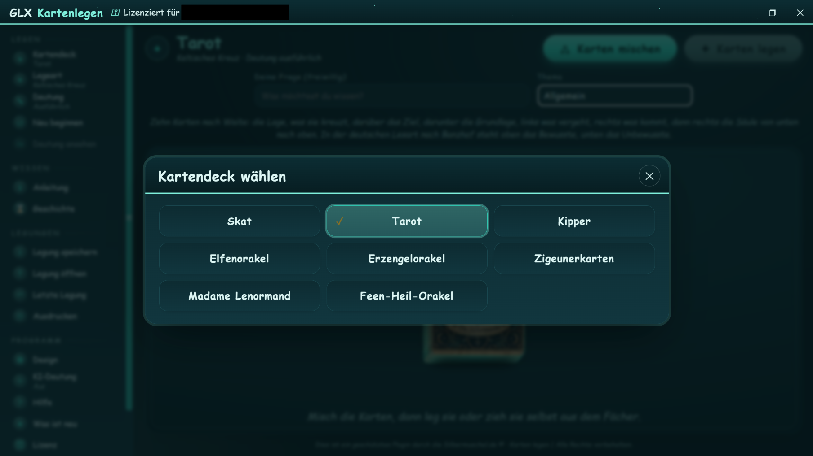
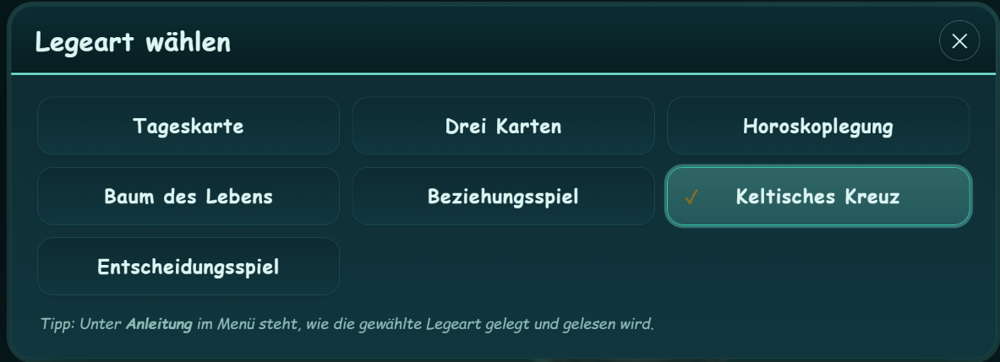
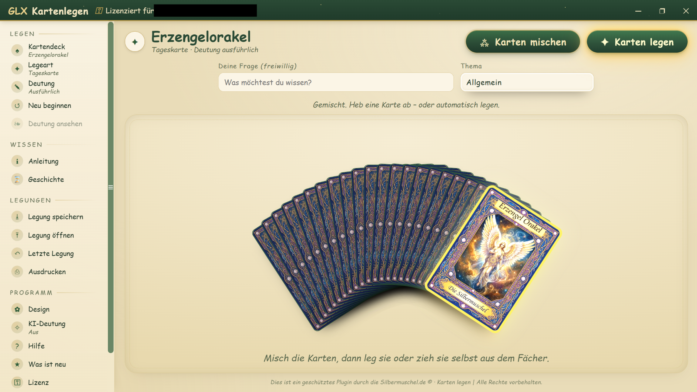
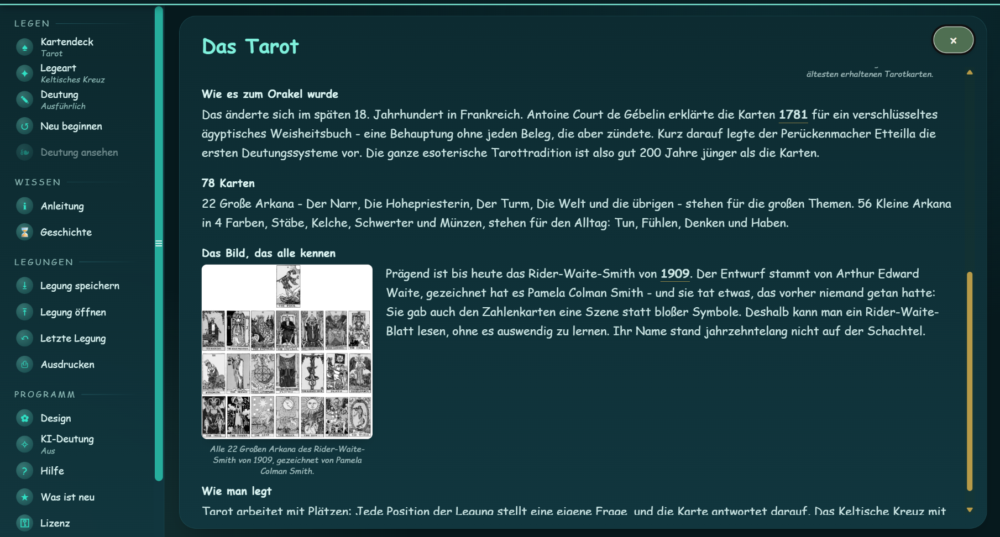
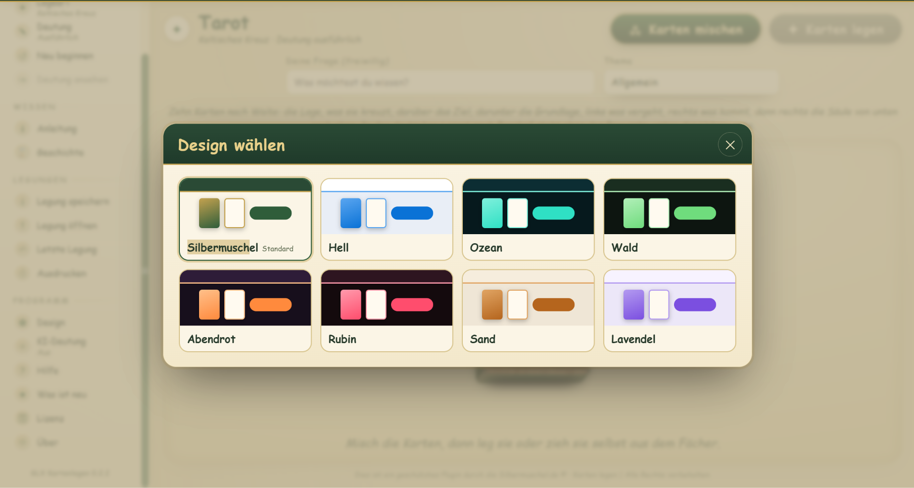
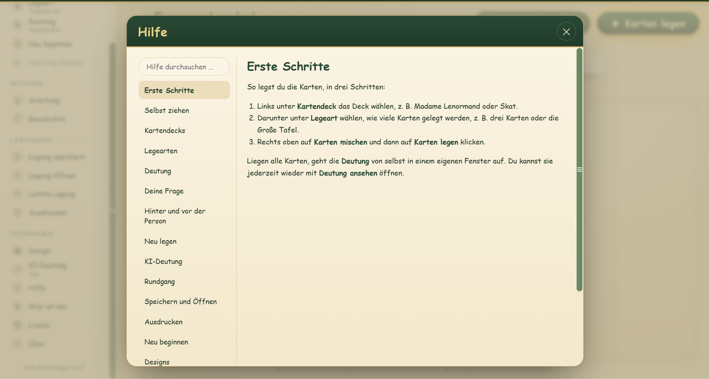

🌍 Languages: [🇺🇸 English](README.md) | [🇩🇪 Deutsch](README.de.md)

# 💠 GLX Kartenlegen

### Card reading like at your own table.

*Eight decks, many spreads and detailed readings in one Windows program, without browser and without ads. User interface in German.* ⚡

   

---

## ⬇️ Download

👉 Latest version: [Releases](../../releases/latest)  
👉 Shop and licences: [glx-tools.de](https://glx-tools.de/product/glx-kartenlegen/)

---

## 📖 About GLX Kartenlegen

### Card reading like at your own table

GLX Kartenlegen brings the card reader from silbermuschel.de to your Windows PC as a standalone program. The card table sits large on the right, a small, clear menu on the left. You shuffle, lay out and read the interpretation at your own pace, without a browser and without ads.

### Created with Regina Toumi

GLX Kartenlegen and all card systems in it were created in cooperation with Regina Toumi. With her support the decks, spreads and interpretations were put together so that they feel like a reading at a real table.

### Eight card decks in one program

Madame Lenormand (36 cards), Kipper (36), Tarot (78), Skat (32), Gypsy cards (52), Elf Oracle (55), Archangel Oracle and Fairy Healing Oracle. Each deck has its own lovingly designed card images and card backs.

### Shuffle, cut, lay out

One click shuffles the cards and fans them out on the table. Let the program lay the cards or draw them yourself one by one from the fan. Each card moves to its place, and a click on a laid card shows its meaning in exactly that position.

### Spreads from the daily card to the Grand Tableau

Each deck has its own spreads, from a single card to three or five cards up to the Grand Tableau with all 36 Lenormand cards. The guide shows a drawing of where each card lies and explains how to lay, turn over and read.

### Short or detailed interpretation

Once all cards are laid, the interpretation opens by itself in a large window: first an overall message with advice, below it every card to expand. You choose a short or detailed reading. The interpretation can be printed or saved as a PDF.

### Save and share readings

Every reading is saved as a small file with the extension .ginax. Double-clicking it opens GLX Kartenlegen and lays the same cards with the same interpretation on the table again. Keep your readings or send them to others who also have GLX Kartenlegen.

### History of the decks

Where does Lenormand come from, how did Tarot begin? Every deck comes with its history and reading tips, right in the program, large and easy to read.

### Warm, clear, easy for everyone

8 designs: Silbermuschel, Light, Ocean, Forest, Sunset, Ruby, Sand and Lavender. Large buttons, a friendly font, tooltips and built-in help with search. The program starts in full screen and remembers your design.

### Your computer, your cards

GLX Kartenlegen works on your PC. Cards, interpretations and saved readings are never sent to the internet. Only the update check asks glx-tools.de for a new version, which you install with one click.

### Try it free for 14 days

Try everything for 14 days without limits. After that you unlock the program with your licence key. The guide and the history of the decks remain readable without a licence.

---

## 📸 Overview & Screenshots

### 1️⃣ Choose from eight card decks

### 2️⃣ Choose the spread

### 3️⃣ Draw the cards yourself from the fan

### 4️⃣ Background knowledge for every deck

### 5️⃣ Choose a design

### 6️⃣ Built-in help

---

## ✨ Features

- 🚀 **Eight decks in one program:** Madame Lenormand (36), Kipper (36), Tarot (78), Skat (32), Gypsy cards (52), Elf oracle (55), Archangel oracle and Fairy healing oracle.
- 🧩 **Shuffle, cut and lay:** Cards are shuffled and fanned out with one click. Let the program lay them or draw card by card yourself.
- ⚙️ **Spreads for every deck:** From the day card over three and five cards to the Grand Tableau, each shown with a drawing of the layout.
- 🔒 **Readings short or detailed:** An overall message with advice, then every card to unfold, at its exact position in the spread.
- 📂 **Print or PDF:** Print the reading or save it as a PDF file.
- ⚡ **Save and share readings:** Every reading is saved as a small .ginax file; a double-click lays the same cards with the same reading again.
- 🎨 **History of the decks:** Background and reading tips for every deck, large and easy to read, free even without a licence.
- 🌍 **Warm and easy to use:** 8 designs, large buttons, a friendly font, tooltips and built-in help with search, full-screen start.
- 🛠️ **Private:** Cards, readings and saved spreads stay on your PC. Only the update check contacts glx-tools.de.
- 📊 **Created with an expert:** Decks, spreads and readings were put together with card reader Regina Toumi.

---

## 🧩 Requirements

- Windows 10 or Windows 11 (64-bit)
- Microsoft Edge WebView2 (included in current Windows versions)

---

## 🧪 Trial & License

Free and unrestricted for 14 days. After that you unlock it with your licence key from [glx-tools.de](https://glx-tools.de). Guide and history of the decks stay readable without a licence.

---

## 🔐 Privacy

Cards, readings and saved spreads are never sent to the internet. Only the update check contacts glx-tools.de.

---

## 🔗 More about this product

👉 [glx-tools.de](https://glx-tools.de/product/glx-kartenlegen/)  
For support: **info@glx-tools.de**

---

## 📄 License

Copyright © 2026 GLX Tools – Gordon Lehmann. All rights reserved.  
This is proprietary commercial software. No open-source license is granted. This repository contains release downloads and documentation only; the source code is not published.

---

Made with ❤️ by **Dreamdancer100**

